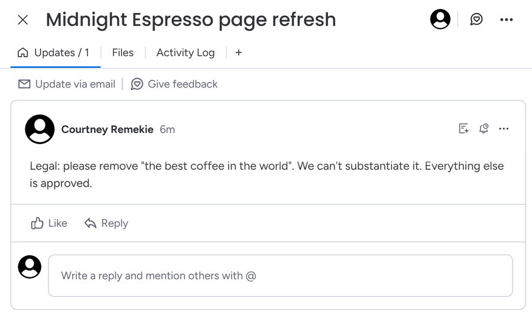
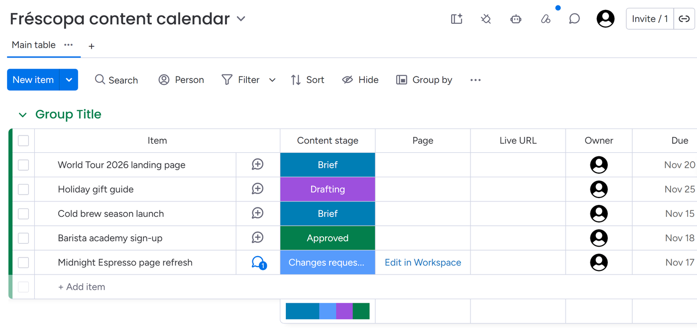
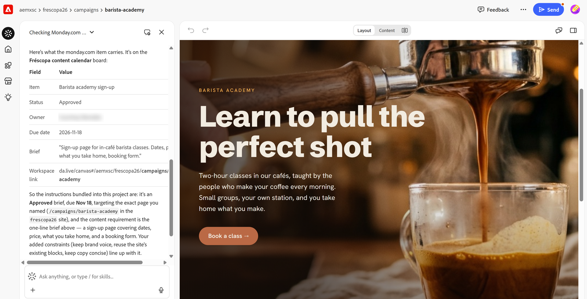
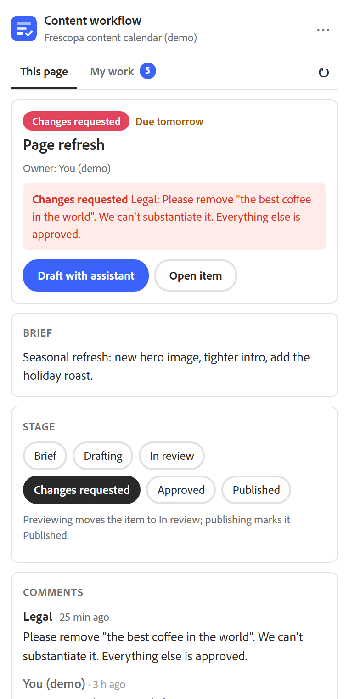
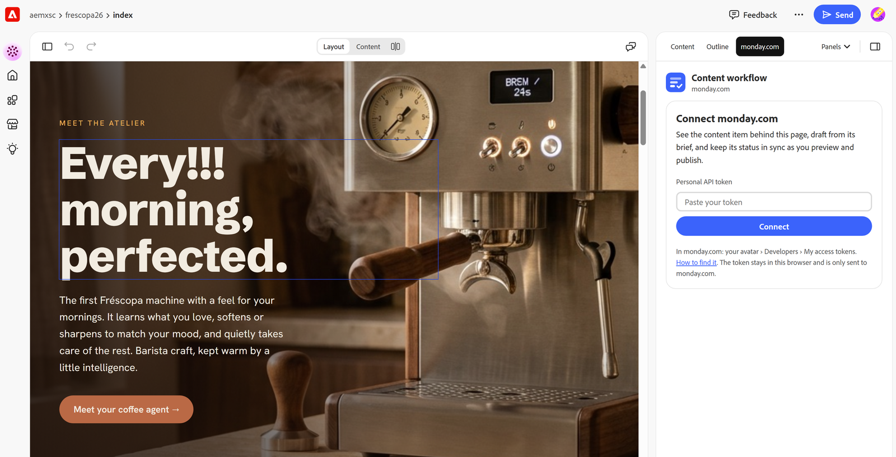

# Content workflow for Experience Workspace · monday.com

A side panel for [Adobe Experience Workspace](https://www.aem.live/docs/ew/developing/apps-plugins)
that connects the page an author is editing to its item on a
[monday.com](https://monday.com) content board.


## The problem

Many content teams plan their work in monday.com, not in Adobe Workfront: the
briefs, the owners, the due dates and the review comments all live on a board.
Authors then write the pages in Workspace, and the two never meet. Authors
copy the brief across by hand, paste preview links into comments, and move
statuses themselves. Nobody sees in Workspace that Legal asked for a change
before the page goes live.

This panel brings the board into Workspace and keeps it up to date as the
author works.

## How an author uses it

1. **Open a page.** The panel shows its monday.com item: stage, due date,
   owner, the brief and the comments. A page without an item gets **Link to an
   existing item** or **Create item from this page**.
2. **Draft from the brief.** **Draft with assistant** puts the brief and the
   reviewers' comments into the Workspace assistant, ready to send. **Insert
   brief** puts it in the page instead.
3. **Send it for review by previewing.** Preview the page as usual: the item
   moves to *In review*, with the preview link as a comment. Nothing to copy.
4. **See what reviewers decided.** Reviewers keep working in monday.com. When
   one sets *Changes requested*, the author sees a warning with the reviewer's
   comment, like the one above, before they publish. Authors reply from the
   panel.

   
5. **Publish.** The item moves to *Published* and gets the live URL.
6. **My work.** A second tab lists everything assigned to the author on the
   board, overdue first, with a link to each page.

On the board, the **Page** column links every item back to its page in
Workspace:



With monday.com's MCP server added ([optional](#optional-let-the-assistant-talk-to-mondaycom-too)),
the Workspace assistant can answer questions about the board too:



For teams on Wrike, Asana or Smartsheet, the panel reaches monday.com through
one small adapter, so those tools can follow
([see below](#other-work-management-tools)).

This plugin is not made or endorsed by monday.com. The rest of this README is
for site admins. Authors can start with the [author guide](docs/authors.md).

## Try it without an account

[Open the demo](https://main--ew-monday--aemxsc.aem.page/tools/monday/monday.html?demo=1&org=aemxsc&site=frescopa26&path=/campaigns/autumn-house-blend):
sample Fréscopa board data, nothing leaves the browser. Buttons at the bottom
simulate previewing and publishing the page so you can watch the item move
through the stages. Add `?demo=1` to the library `path` to try it inside
Workspace the same way.



## Before you start

- **An Experience Workspace site** (a DA site with Experience Workspace
  enabled).
- **A monday.com account with API access** for each author. Each author uses
  their own personal API token, so items and comments show their name.
- **A content board.** Any board works. The panel offers to add the columns it
  needs (see [Board columns](#board-columns)). For a ready-made demo board, run
  the [seed script](#demo-board).

## Add it to a site

1. Open the site config: `https://da.live/config#/{org}/{site}/`.
2. In the `library` sheet (add a tab called `library` if there is none), add a
   row:

   | title | path | icon |
   |---|---|---|
   | monday.com | `https://main--ew-monday--aemxsc.aem.page/tools/monday/monday.html` | `https://main--ew-monday--aemxsc.aem.page/tools/monday/icon.svg` |

   Leave `ref`, `experience` and `format` empty. The title is the name authors
   see in the **Panels** menu.
3. Save the config.
4. Open a page of the site in Workspace and choose **monday.com** in the
   **Panels** menu under Extensions. It opens as a tab next to Content and
   Outline:

   
5. Send authors the [author guide](docs/authors.md). Each author pastes their
   monday.com token once and picks the board.

### Optional: let the assistant talk to monday.com too

The panel covers the page-to-item workflow. For everything else ("what's due
this week across the board?", "move the gift guide to next Friday"), give the
Workspace assistant monday.com's hosted MCP server. Add it where your
assistant's integrations are managed (for Coworker: **Customizations ›
Integrations › Add server**):

- **Name:** `monday`
- **URL:** `https://mcp.monday.com/mcp` (HTTP)
- **Authentication:** None
- **Header:** `Authorization` = `Bearer {monday.com API token}`, with a space
  after `Bearer`. Store it as a secret where that's offered.

Then start a new chat session and ask "List my monday.com boards". Everyone
using that integration acts as the token's monday.com user, so outside of
demos use a dedicated service user. See
[monday.com's MCP docs](https://developer.monday.com/api-reference/docs/mcp-api-token).

### Run your own copy

The row above loads the code from this repository, so changes here reach your
authors without review, and the code can read their monday.com token. To review
updates first:

1. Fork this repository.
2. Install [AEM Code Sync](https://github.com/apps/aem-code-sync/installations/new)
   on the fork.
3. Use `https://main--{repo}--{owner}.aem.page/tools/monday/monday.html` (and
   `icon.svg`) in the library row.

There is no build step and there are no dependencies: the panel is plain
JavaScript modules.

## Board columns

The panel finds columns by title first, then by type. If the board lacks the
required ones, the panel shows **Add the columns**, which creates them and
changes nothing else.

| Column | Type | Required | Used for |
|---|---|---|---|
| Content stage | Status | yes | The workflow stage. Any status column works; one titled *Content stage* wins. |
| Page | Link | yes | The Workspace edit link that ties the item to the page. |
| Live URL | Link | no | Written on publish. |
| Owner | People | no | *My work*, and the owner of items made from a page. |
| Due | Date (or Timeline) | no | Due and overdue badges. A timeline's end date counts as due. |
| Brief | Long text | no | The brief shown in the panel and given to the assistant. |

The stages are `Brief`, `Drafting`, `In review`, `Changes requested`,
`Approved` and `Published`. Labels that the status column doesn't have yet are
created the first time they are used.

## What happens when

| Author action | monday.com |
|---|---|
| Create item from this page | New item, named after the page's first heading, stage *Drafting*, owner = author, Page link set. |
| Link to an existing item | Page link set, stage *Drafting*. |
| Preview the page | If the item is in *Brief*, *Drafting* or *Changes requested*: stage *In review*, plus a comment with the preview URL. |
| Publish the page | Stage *Published*, Live URL set, plus a comment with the live URL. |
| Set the stage in the panel | Stage changes, plus a comment saying who changed it. |
| Post a comment | A monday.com update on the item. |

Comments written by the panel start with `Experience Workspace ·`, so the
panel can tell them from reviewers' comments. The first time the panel sees an
item, it takes the page's current preview and publish state as the starting
point, so earlier previews don't change the stage.

## What data goes where

- **The monday.com token** stays in the author's browser, in local storage of
  the panel's web address. It is sent only to `api.monday.com`, never to Adobe
  and never into the site config. **Disconnect** in the **⋯** menu removes it.
- **monday.com gets** the page's Workspace edit URL, its preview and live URLs,
  the page's first heading (as an item name) and the comments the author posts.
- **Adobe's APIs** are called with the author's Workspace sign-in, the same way
  the editor does, only to read the page's preview/publish state
  (`admin.hlx.page/status`) and its heading (`admin.da.live/source`). The panel
  never changes the page, except when the author clicks **Insert brief**.

## Limits

- Status sync runs while the panel is open (on open and every 20 seconds). A
  page published with the panel closed is synced the next time someone opens
  the panel on it.
- The panel warns about unapproved pages but cannot block publishing:
  Experience Workspace has no hook for that.
- Boards are read up to 500 items.
- If the admin status API can't be read for a site, the panel says so and
  authors set the stage by hand.
- Tested on classic DA sites.

## Demo board

`scripts/seed-board.mjs` creates a board with the columns and five items in
different stages, owned by you:

```sh
MONDAY_TOKEN=your-token node scripts/seed-board.mjs --org aemxsc --site frescopa26 --review-page campaigns/autumn-house-blend
```

Write the page path without a leading slash: on Windows, Git Bash turns
`/campaigns/...` into a `C:/Program Files/Git/...` path. The script needs
Node.js 20 or later.

`--review-page` links one item to an existing page in *Changes requested*, with
a legal comment, so the review warning shows straight away.

## Other work-management tools

`tools/monday/api.js` is the only file that knows monday.com. It maps boards
and items into a tool-neutral work item and implements this contract:

| Method | Returns |
|---|---|
| `me()` | `{ id, name }` |
| `boards()` | `[{ id, name }]` |
| `board(id)` | `{ id, name, url, columns, missing, ready }` |
| `prepareBoard(board)` | the board, with missing columns added |
| `items(board)` | `[{ id, name, url, stage, stageColor, due, owners, brief, pageUrl, liveUrl, updates }]` |
| `createItem(board, { name, pageUrl, ownerId, stage })` | new item id |
| `updateItem(board, id, { stage, pageUrl, liveUrl })` | nothing |
| `addNote(id, text)` | nothing |

A Wrike, Asana or Smartsheet adapter with the same methods drops into
`panel.js` through its `adapterFactory` option.

## Develop

```sh
npm test            # unit tests (node --test), no install needed
npx @adobe/aem-cli up   # serves the panel at http://localhost:3000
```

Open `http://localhost:3000/tools/monday/monday.html?org={org}&site={site}&path=/{page}`
to run it outside Workspace (standalone mode starts after 3 seconds). To load
your local copy inside Workspace, use `http://localhost:3000/tools/monday/monday.html`
as the library `path`.

| File | What it does |
|---|---|
| `tools/monday/monday.html` | Page loaded in the side-panel iframe |
| `tools/monday/monday.js` | Waits for the Workspace SDK, falls back to standalone |
| `tools/monday/panel.js` | UI and flows |
| `tools/monday/model.js` | Workflow rules: matching, sync, review gate, prompts (pure, tested) |
| `tools/monday/api.js` | monday.com adapter (GraphQL) |
| `tools/monday/page.js` | Page preview/publish state and heading |
| `tools/monday/storage.js` | Token, board and sync markers in local storage |

## License

Apache 2.0. See [LICENSE](LICENSE).
