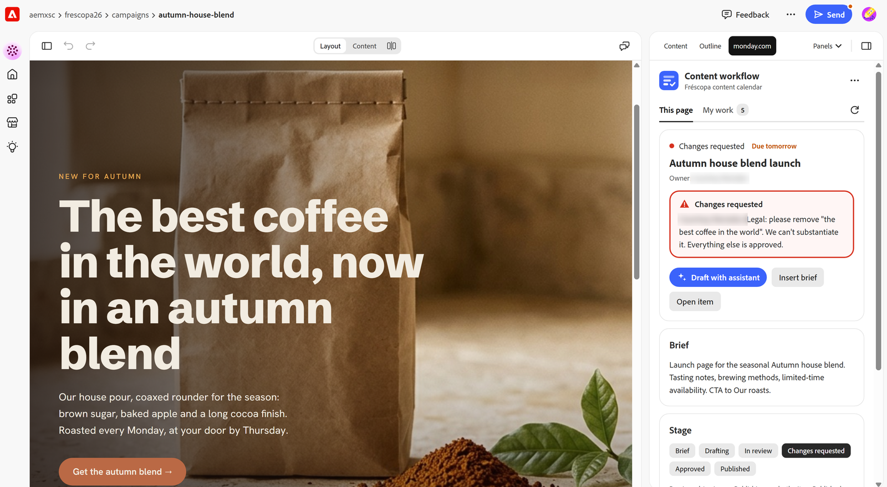
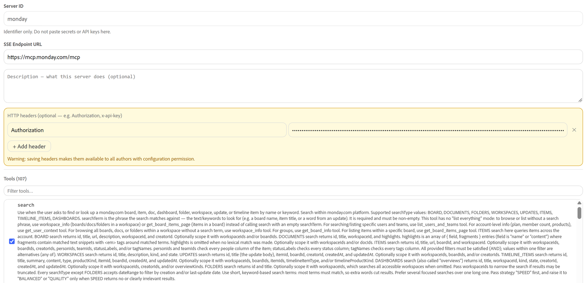

# Content workflow for Experience Workspace · monday.com

A side panel for [Adobe Experience Workspace](https://www.aem.live/docs/ew/developing/apps-plugins)
that connects the page an author is editing to its item on a
[monday.com](https://monday.com) content board.

- **See the work behind the page.** Stage, due date, owner, the brief and the
  review comments, next to the canvas.
- **Draft from the brief.** One click hands the brief and the reviewers'
  comments to the Workspace assistant. Or insert the brief into the page.
- **Status follows the page.** Preview the page and the item moves to
  *In review*. Publish it and the item moves to *Published*, with the live URL
  written back. No copying links into monday.com.
- **Review loop.** When a reviewer sets *Changes requested* in monday.com, the
  author sees it, with the reviewer's comment, before they publish. Authors can
  reply from the panel.
- **My work.** Everything assigned to you on the board, overdue first, with a
  link straight to each page.

Built for teams that plan content in monday.com rather than Adobe Workfront.
The panel talks to monday.com through a small adapter
([see below](#other-work-management-tools)), so Wrike, Asana or Smartsheet can
follow without touching the panel.

This plugin is not made or endorsed by monday.com.



The author opens the page and sees what the content team decided: the item is
in *Changes requested*, and Legal's comment says the headline's claim has to
go. The brief and stage are right there too.


On the board, the **Page** column links each item back to its page in
Workspace.

This README is for site admins. For how to use the panel, see the
[author guide](docs/authors.md).

## Try it without an account

[Open the demo](https://main--ew-monday--aemxsc.aem.page/tools/monday/monday.html?demo=1&org=aemxsc&site=frescopa26&path=/campaigns/autumn-house-blend):
sample Fréscopa board data, nothing leaves the browser. Buttons at the bottom
simulate previewing and publishing the page so you can watch the item move
through the stages. Add `?demo=1` to the library `path` to try it inside
Workspace the same way.


## Before you start

- **An Experience Workspace site** (a DA site with Experience Workspace
  enabled).
- **A monday.com account with API access** for each author. Each author uses
  their own personal API token, so items and comments show their name.
- **A content board.** Any board works. The panel offers to add the columns it
  needs (see [Board columns](#board-columns)). For a ready-made demo board, run
  the [seed script](#demo-board).

## Add it to a site

1. Open the site config: `https://da.live/config#/{org}/{site}/`.
2. In the `library` sheet (add a tab called `library` if there is none), add a
   row:

   | title | path | icon |
   |---|---|---|
   | monday.com | `https://main--ew-monday--aemxsc.aem.page/tools/monday/monday.html` | `https://main--ew-monday--aemxsc.aem.page/tools/monday/icon.svg` |

   Leave `ref`, `experience` and `format` empty. The title is the name authors
   see in the **Panels** menu.
3. Save the config.
4. Open a page of the site in Workspace and choose **monday.com** in the
   **Panels** menu under Extensions. It opens as a tab next to Content and
   Outline:

   
5. Optional: to open the panel on every page instead of Workspace's default
   panel, add `ew.canvasDefaultPanel` = `monday.com` (the library row's
   title) to the `flags` sheet.
6. Send authors the [author guide](docs/authors.md). Each author pastes their
   monday.com token once and picks the board.

### Optional: let the assistant talk to monday.com too

The panel handles the page-to-item workflow. For questions the panel doesn't
answer ("what's due this week across the board?", "move the gift guide to next
Friday"), add monday.com's hosted MCP server so the Workspace assistant can use
it. Open the Skills editor at `https://da.live/apps/skills#/{org}/{site}`, go
to **MCPs** and add a server:

- **Server ID:** `monday`
- **Endpoint URL:** `https://mcp.monday.com/mcp`
- **HTTP header:** `Authorization` = `Bearer {monday.com API token}`

The editor lists the server's tools (107 at the time of writing) once it
connects, which confirms the token works. Then start a new chat session and ask
"List my monday.com boards".



The token is shared: everyone who uses the assistant on the site
acts as that monday.com user, and site admins can read it in the config. Use a
dedicated service user for it, not a personal token, outside of demos. See
[monday.com's MCP docs](https://developer.monday.com/api-reference/docs/mcp-api-token).

### Run your own copy

The row above loads the code from this repository, so changes here reach your
authors without review, and the code can read their monday.com token. To review
updates first:

1. Fork this repository.
2. Install [AEM Code Sync](https://github.com/apps/aem-code-sync/installations/new)
   on the fork.
3. Use `https://main--{repo}--{owner}.aem.page/tools/monday/monday.html` (and
   `icon.svg`) in the library row.

There is no build step and there are no dependencies: the panel is plain
JavaScript modules.

## Board columns

The panel finds columns by title first, then by type. If the board lacks the
required ones, the panel shows **Add the columns**, which creates them and
changes nothing else.

| Column | Type | Required | Used for |
|---|---|---|---|
| Content stage | Status | yes | The workflow stage. Any status column works; one titled *Content stage* wins. |
| Page | Link | yes | The Workspace edit link that ties the item to the page. |
| Live URL | Link | no | Written on publish. |
| Owner | People | no | *My work*, and the owner of items made from a page. |
| Due | Date (or Timeline) | no | Due and overdue badges. A timeline's end date counts as due. |
| Brief | Long text | no | The brief shown in the panel and given to the assistant. |

The stages are `Brief`, `Drafting`, `In review`, `Changes requested`,
`Approved` and `Published`. Labels that the status column doesn't have yet are
created the first time they are used.

## What happens when

| Author action | monday.com |
|---|---|
| Create item from this page | New item, named after the page's first heading, stage *Drafting*, owner = author, Page link set. |
| Link to an existing item | Page link set, stage *Drafting*. |
| Preview the page | If the item is in *Brief*, *Drafting* or *Changes requested*: stage *In review*, plus a comment with the preview URL. |
| Publish the page | Stage *Published*, Live URL set, plus a comment with the live URL. |
| Set the stage in the panel | Stage changes, plus a comment saying who changed it. |
| Post a comment | A monday.com update on the item. |

Comments written by the panel start with `Experience Workspace ·`, so the
panel can tell them from reviewers' comments. Reviewers keep working where
they already are: a comment on the item in monday.com is what the author sees
in the panel.


## What data goes where

- **The monday.com token** stays in the author's browser, in local storage of
  the panel's web address. It is sent only to `api.monday.com`, never to Adobe
  and never into the site config. **Disconnect** in the **⋯** menu removes it.
- **monday.com gets** the page's Workspace edit URL, its preview and live URLs,
  the page's first heading (as an item name) and the comments the author posts.
- **Adobe's APIs** are called with the author's Workspace sign-in, the same way
  the editor does, only to read the page's preview/publish state
  (`admin.hlx.page/status`) and its heading (`admin.da.live/source`). The panel
  never changes the page, except when the author clicks **Insert brief**.

## Limits

- Status sync runs while the panel is open (on open and every 20 seconds). A
  page published with the panel closed is synced the next time someone opens
  the panel on it.
- The panel warns about unapproved pages but cannot block publishing:
  Experience Workspace has no hook for that.
- Boards are read up to 500 items.
- If the admin status API can't be read for a site, the panel says so and
  authors set the stage by hand.
- Tested on classic DA sites.

## Demo board

`scripts/seed-board.mjs` creates a board with the columns and five items in
different stages, owned by you:

```sh
MONDAY_TOKEN=your-token node scripts/seed-board.mjs --org aemxsc --site frescopa26 --review-page campaigns/autumn-house-blend
```

Write the page path without a leading slash on Windows: Git Bash turns
`/roasts/...` into a `C:/Program Files/Git/...` path.

`--review-page` links one item to an existing page in *Changes requested*, with
a legal comment, so the review warning shows straight away.

## Other work-management tools

`tools/monday/api.js` is the only file that knows monday.com. It maps boards
and items into a tool-neutral work item and implements this contract:

| Method | Returns |
|---|---|
| `me()` | `{ id, name }` |
| `boards()` | `[{ id, name }]` |
| `board(id)` | `{ id, name, url, columns, missing, ready }` |
| `prepareBoard(board)` | the board, with missing columns added |
| `items(board)` | `[{ id, name, url, stage, stageColor, due, owners, brief, pageUrl, liveUrl, updates }]` |
| `createItem(board, { name, pageUrl, ownerId, stage })` | new item id |
| `updateItem(board, id, { stage, pageUrl, liveUrl })` | nothing |
| `addNote(id, text)` | nothing |

A Wrike, Asana or Smartsheet adapter with the same methods drops into
`panel.js` through its `adapterFactory` option.

## Develop

```sh
npm test            # unit tests (node --test), no install needed
npx @adobe/aem-cli up   # serves the panel at http://localhost:3000
```

Open `http://localhost:3000/tools/monday/monday.html?org={org}&site={site}&path=/{page}`
to run it outside Workspace (standalone mode starts after 3 seconds). To load
your local copy inside Workspace, use `http://localhost:3000/tools/monday/monday.html`
as the library `path`.

| File | What it does |
|---|---|
| `tools/monday/monday.html` | Page loaded in the side-panel iframe |
| `tools/monday/monday.js` | Waits for the Workspace SDK, falls back to standalone |
| `tools/monday/panel.js` | UI and flows |
| `tools/monday/model.js` | Workflow rules: matching, sync, review gate, prompts (pure, tested) |
| `tools/monday/api.js` | monday.com adapter (GraphQL) |
| `tools/monday/page.js` | Page preview/publish state and heading |
| `tools/monday/storage.js` | Token, board and sync markers in local storage |

## License

Apache 2.0. See [LICENSE](LICENSE).
