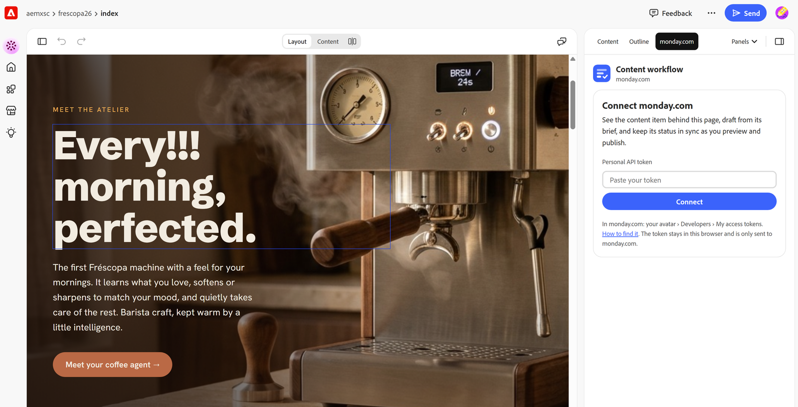
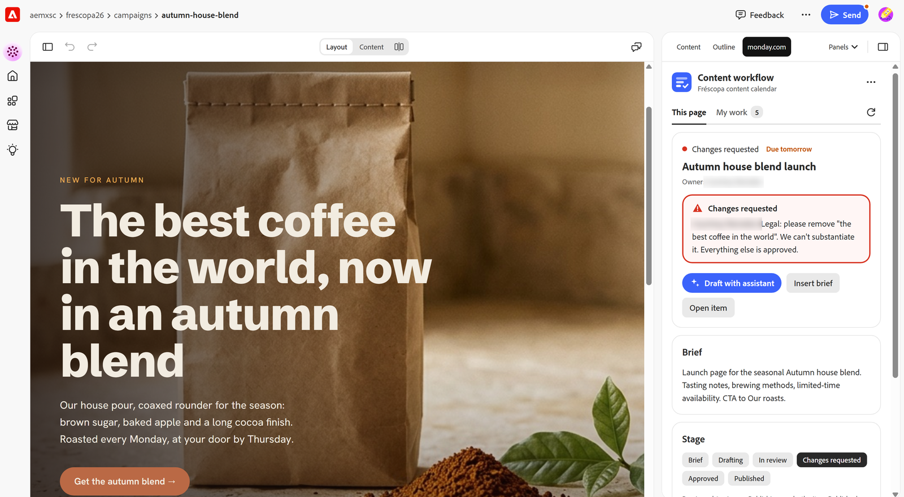

# Using the monday.com panel

The panel shows the monday.com item behind the page you're editing and keeps
it up to date as you work.

## Connect once

1. In monday.com, click your avatar, then **Developers** › **My access tokens**,
   and copy your token.
2. In Experience Workspace, open any page and choose **monday.com** in the
   **Panels** menu.
3. Paste the token and click **Connect**.

   
4. Pick your team's content board. The panel remembers it for the whole site.

The token stays in your browser. To remove it, open **⋯** › **Disconnect
monday.com**.

## Start a page from a brief

1. Open the page (or create it) in Workspace.
2. In the panel, either **Link to an existing item**, or click **Create item
   from this page** if nobody has planned it yet.
3. Click **Draft with assistant**. The brief and the comments on the item land
   in the assistant. Check the prompt and press send.

**Insert brief** puts the brief into the page at your cursor instead, as notes
to write over.

## Send it for review

Preview the page as usual. The item moves to **In review** and gets a comment
with the preview link, so reviewers know it's ready.

If a reviewer sets **Changes requested**, a red note at the top of the panel
shows their comment. Fix the page, reply in **Comments**, and preview again: the
item goes back to **In review**.

You can also set the stage yourself in the **Stage** picker.

## Publish

Publish once the item is **Approved**: the panel turns green and says *Ready
to publish*, with the reviewer's comment if they left one. If your team set up
the approval automation, monday.com also notifies you. The panel warns you if
the item isn't approved, but it doesn't stop you. After publishing, the item moves to **Published** and gets the
live link.

The panel updates monday.com while it is open. If you publish with the panel
closed, the item updates the next time someone opens the panel on that page.

## My work

The **My work** tab lists the items assigned to you that aren't published yet,
soonest due first. Overdue items are red. Click one to open its page.
